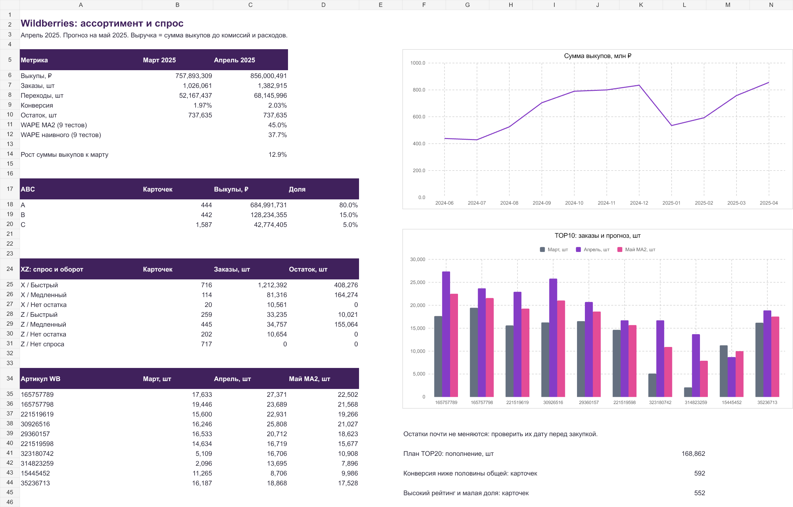

# Wildberries: анализ ассортимента, спроса и запасов

Решение тестового задания аналитика отдела планирования. На основе **11 месячных выгрузок за июнь 2024 - апрель 2025** выполнены ABC/XZ-сегментация, прогноз заказов TOP10 на май 2025, историческая проверка WAPE, анализ конверсии и условный план запасов TOP20. Дата подготовки: **16 октября 2026 года**.

## С чего начать

1. Откройте [краткий отчёт на 3 страницы](outputs/wildberries/Wildberries_отчёт.pdf): результаты, рекомендации и ограничения.
2. Посмотрите [Excel с формулами и дашбордом](outputs/wildberries/Wildberries_аналитика.xlsx). Для просмотра запуск кода не нужен.
3. Прочитайте [подробный конспект выполнения](docs/Конспект.md): что делалось по порядку, зачем, по каким формулам и как проверялось.
4. При необходимости используйте [глоссарий](docs/Глоссарий.md) и [таблицы CSV](data/).



## Главные результаты

| Показатель | Результат |
| --- | ---: |
| Строк истории | 26 106 |
| Уникальных WB за всю историю | 2 549 |
| Карточек в апреле | 2 473 |
| Сумма выкупов апреля | 856 000 491 ₽ |
| Рост выкупов к марту | 12,94% |
| Заказы апреля | 1 382 915 шт |
| Заказы / переходы апреля | 2,029% |
| ABC: A / B / C, карточек | 444 / 442 / 1 587 |
| Прогноз MA2 на май для TOP10 | 164 981 шт |
| WAPE MA2 на 90 исторических прогнозах | 45,03% |
| WAPE прогноза «как в прошлом месяце» | 37,66% |
| Условное пополнение TOP20 | 168 862 шт |

**MA2 оказалась хуже наивного прогноза.** Это явно отражено в результатах: модель запаздывает при росте. Майского факта нет, качество именно майского прогноза пока неизвестно. Результат MA2 оставлен как простая модель из ТЗ; для закупок необходимо сравнить с наивной базой и проверить альтернативы на новом отложенном периоде.

## Что выполнено по ТЗ

| Пункт | Метод | Результат |
| --- | --- | --- |
| 1a. ABC последнего месяца | По выкупам апреля, пороги 80/95% | `assortment_april.csv`, `abc_summary.csv`, «Ассортимент» |
| 1b. XZ по заказам и обороту | Спрос относительно медианы, заказы / остаток | `xz_summary.csv`, «Ассортимент», дашборд |
| 2a. Прогноз TOP10 | MA2 по марту и апрелю | `forecast_top10.csv`, «Прогноз TOP10» |
| 2b. Точность | 9 исторических месяцев × 10 карточек, WAPE | `backtest_detail.csv`, `backtest_summary.csv`, «Проверка прогноза» |
| 3a. Низкая конверсия | Трафик ≥1000, конверсия <½ портфельной | `low_conversion.csv` |
| 3b. Рейтинг и малая доля | Рейтинг ≥9, доля <0,1%, трафик ≥1000, не удалён | `marketing_candidates.csv` |
| 4a–b. Запасы TOP20 | Фактический остаток, покрытие, MA2 + 20% | `stock_top20.csv`, «Запасы TOP20» |
| 5a. Дашборд | Excel: KPI, ABC/XZ, два редактируемых графика | `Wildberries_аналитика.xlsx` |
| 5b. Глоссарий | Формулы, единицы и ограничения | `docs/Глоссарий.md` |
| Краткий отчёт | 3 страницы PDF | `Wildberries_отчёт.pdf` |

## Методика и существенные ограничения

**Единица анализа:** отдельная карточка «Артикул WB». Ключ фактов: месяц + WB. Разные варианты не объединяются в головную модель. Идентификаторы хранятся текстом. Пропуски истории не заменяются нулями.

**Выручка:** поле «Выкупили на сумму, ₽», до комиссий, логистики, налогов и иных расходов. Это не прибыль и не чистая сумма к перечислению продавцу. Конверсия портфеля - отношение сумм заказов и переходов, не среднее карточных конверсий.

**ABC:** карточки отсортированы по выкупам. Карточка, пересекающая порог 80% или 95%, включается в предшествующую группу. Нулевые выкупы относятся к C. Равные суммы упорядочены по WB. Поэтому группа A покрывает чуть больше 80% суммы.

**XZ:** в ТЗ не заданы пороги и трактовка. Принято: X - заказы не ниже медианы положительных заказов апреля (271,5 шт), Z - ниже. Быстрый оборот - заказы / (остаток WB + МП) ≥1. При нулевом остатке выделена отдельная категория. Это рабочая XZ-матрица, **не стандартный XYZ** по коэффициенту вариации и не оборачиваемость по среднему запасу.

**Прогноз:** среднее двух месячных объёмов заказов. Операционный прогноз округляется вверх, исторический тест оценивает неокруглённую MA2. Сезонность, разное число дней и потерянный спрос при отсутствии товара не моделируются.

**Честный backtest:** для тестового месяца t TOP10 выбирается по выкупам t−1, а прогноз использует только t−2 и t−1. Проверка с августа 2024 по апрель 2025, 90 прогнозов, пропусков нет. WAPE = Σ|факт − прогноз| / Σфакт. Общий WAPE вычисляется из общих сумм, не средним месячных процентов. Историческая ошибка меняющегося TOP10 не гарантирует аналогичную ошибку текущего TOP10.

**Конфликт периодов:** текущие значения отдельного месячного файла не всегда совпадают с колонками «предыдущий период» следующего. В апреле относительно отдельного марта: 1021 расхождение заказов и 941 по выкупам среди 2428 общих WB. Используются только собственные текущие значения каждого месяца; предыдущие колонки не добавляются к истории. Все сравнения доступны в `previous_period_checks.csv`. Причина расхождений не установлена.

**Актуальность остатков:** у 2041 из 2192 карточек с полной 11-месячной историей остаток полностью неизменен. Почти одинаков и общий остаток. Историческая дата складского среза не подтверждена. План запасов - **условный сценарий до проверки складских данных**.

**План TOP20:** использован настоящий столбец остатка, поскольку цена и число заказов не позволяют определить физический запас. Цель = MA2 × 1,20; пополнение = MAX(цель − остаток, 0). 20% - принятое допущение, не статистически оценённый страховой запас. Входящие поставки, резервы, MOQ, сроки и сервисный уровень неизвестны. Избыток означает возможное снижение новых закупок, не списание товара.

## Excel: как пользоваться

| Лист | Назначение |
| --- | --- |
| Дашборд | Сравнение марта и апреля, выкупы, заказы, конверсия, остаток, ABC, XZ, TOP10 и графики |
| Ассортимент | Все 2473 апрельские карточки, формулы, фильтры и диагностические флаги |
| Прогноз TOP10 | Март, апрель, формула MA2 на май и общая сумма |
| Запасы TOP20 | Остатки, покрытие, цель, пополнение, избыток и решение |
| История | Агрегаты 11 месяцев, расчёт конверсии |
| Проверка прогноза | 90 исторических наблюдений и формулы ошибок/WAPE двух моделей |
| Данные | Исходные значения апреля и сопоставленная мартовская история |

Жёлтые ячейки **C49:C58 на «Дашборде»** содержат правила и допущения. Изменение порогов пересчитывает связанные показатели. Графики привязаны к ячейкам, внешних файловых связей нет.

Состав TOP10/TOP20, порядок ABC и медиана границы X формируются при сборке. После изменения исходной выручки или добавления месяца нужна **повторная сборка**, обычный пересчёт Excel не переупорядочивает карточки. Полная история хранится в CSV, а Excel содержит компактный срез последних двух месяцев и подготовленные исторические агрегаты.

Скрипт `analyze.py` проверяет наличие 11 непрерывных месяцев и в текущем варианте реализует именно этот кейс. Поддержка произвольного числа месяцев потребует изменения проверки, диапазонов и подписей отчёта. Это воспроизводимое тестовое решение, а не универсальная система автопланирования.

## Структура проекта

```text
data/
  raw/                     11 исходных XLSX
  manifest.json            SHA-256, месяцы и число строк
  monthly_facts.csv        нормализованная история 26 106 строк
  monthly_summary.csv      агрегаты по месяцам
  assortment_april.csv     все апрельские карточки и расчёты
  abc_summary.csv
  xz_summary.csv
  forecast_top10.csv
  stock_top20.csv
  low_conversion.csv
  marketing_candidates.csv
  backtest_detail.csv
  backtest_summary.csv
  previous_period_checks.csv
docs/
  Конспект.md              подробный порядок работы и объяснения
  Глоссарий.md
  ТЗ.txt                   текст исходного задания
  dashboard.png            просмотр дашборда на GitHub
outputs/wildberries/
  Wildberries_аналитика.xlsx
  Wildberries_отчёт.pdf
src/
  analyze.py               загрузка, проверки, расчёты, CSV
  prepare_excel.py         подготовка входных данных Excel
  build_excel.mjs          формулы, оформление, графики, проверки, XLSX
  build_docs.py            подробные документы и PDF
  verify.py                проверка экспортированных результатов
validation/
  summary.json             независимые числовые итоги Python
  excel_checks.json        сверки и поиск ошибок формул
  verification.json        проверка готового XLSX/PDF
```

Исходные материалы прежнего проекта Power BI не включены в новую реализацию и не изменялись.

## Воспроизведение

Проверенная среда: Python 3.12.14, Node.js 24.19.0, `@oai/artifact-tool` из предоставленного Codex runtime. Точные версии записаны в `validation/environment.json`.

### 1. Подготовить Python

```powershell
python -m venv .venv
.venv\Scripts\Activate.ps1
python -m pip install -r requirements.txt
```

### 2. Пересчитать анализ

```powershell
python src/analyze.py --source data/raw
python src/prepare_excel.py
```

CSV сохраняются в UTF-8 с BOM. Если Excel открывает CSV в одной колонке, импортируйте через «Данные → Из текста/CSV» с разделителем «запятая». Числа используют десятичную точку, SKU импортируйте текстом.

### 3. Пересобрать Excel

```powershell
node src/build_excel.mjs
```

Нужен доступ к `@oai/artifact-tool`. Это зависимость среды Codex, она не поставляется в репозитории. В проверенной среде `node_modules` связывался с каталогом пакетов, возвращённым `load_workspace_dependencies`; локальные пути пользователя не требуются в исходном коде. Если этот пакет недоступен, анализ CSV и готовый Excel остаются доступными, но пересборка оформления и формул этим скриптом не выполнится. Установка одноимённого стороннего пакета не считается проверенным способом воспроизведения.

### 4. Пересобрать документы и проверить

```powershell
python src/build_docs.py
python src/verify.py
```

PDF использует Arial из `C:/Windows/Fonts`. Для другой ОС замените пути к используемым начертаниям на доступный кириллический шрифт. Документы привязаны к текущему кейсу: не все числовые примеры в текстах динамические. При изменении данных необходимо обновить тексты и снова проверить PDF визуально. SHA-256 исходников автоматически пересчитываются.

### Что проверено

- 11 непрерывных месяцев, обязательные поля, уникальность WB внутри месяца, отсутствие пропусков и отрицательных значений ключевых числовых полей.
- Отсутствие повторного учёта предыдущих периодов; отдельный журнал расхождений.
- Суммы истории, 100% долей, состав ABC, TOP10 и TOP20.
- 90 исторических прогнозов без отбора по будущему месяцу.
- Независимое совпадение Python и Excel по выкупам, прогнозу, пополнению и WAPE.
- Поиск ошибок формул, изменение входных заказов и восстановление значения.
- Наличие двух графиков и их связей с ячейками, экспортированных формул и кэшированных результатов.
- Визуальный просмотр всех листов и трёх страниц PDF.

Нативное приложение Microsoft Excel и Power BI не запускались. Расчёты проверены движком Artifact Tool и независимым чтением сохранённого XLSX. Систему не следует считать проверенной для реальных закупок без подтверждения исходных ограничений.

## Использование данных

Это учебное/тестовое исследование предоставленных выгрузок. Товарные показатели не являются подтверждённой публичной отчётностью Wildberries. Репозиторий опубликован по запросу владельца рабочей копии. Открытая лицензия на исходные данные и материалы третьих лиц не назначается.

